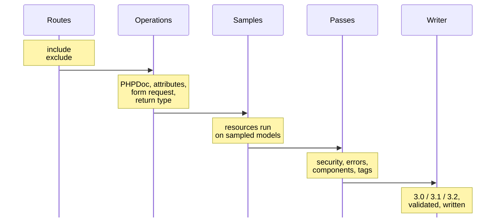

The generator does not parse annotations: it **observes** the application. It collects the routes, builds one
operation per route and method from what the code declares, runs the resources on sampled models, completes the
document (security, errors, components), and hands it to [OpenAPI Writer](/openapi-writer), which writes it in the
OpenAPI version of the document.

## From the routes to the document



1. **Routes.** Every route matching `routes.include` and not `routes.exclude` of the document is collected, one
   operation per HTTP method. See [Routes & operations](/laravel-openapi-generator/documenting-endpoints/routes-and-operations).
2. **Operations.** The PHPDoc and the attributes give the metadata; the form request and its rules give the parameters
   and the body; the return type gives the responses.
3. **Samples.** Each resource is described by running `toArray()` on a sampled model. See
   [Sampling](/laravel-openapi-generator/documenting-endpoints/sampling).
4. **Passes.** Changes over the whole document: the security and the error responses of the middlewares, the 404 of the
   bound models, the 422 of the validation, the responses of the `@throws`, the shared components.
5. **Writing.** The writer converts what the version of the document needs (`nullable` in 3.0, webhooks from 3.1…), and
   the document is validated before it is written.

## What is inferred

| Source | Gives |
| --- | --- |
| The route: URI, methods, name, domain, middlewares, `where` constraints | the path and its parameters, the operation id, the servers of a domain, the security and the 401, 403, 419 and 429 of the middlewares |
| The PHPDoc of the action | the summary (first line), the description (the rest, CommonMark), `@deprecated`, `@throws`, `@return` |
| The parameters of the action | the form request and its `rules()`, the types of the path parameters (`int`, a bound model and its 404, a backed enum) |
| The return type | the responses: resources, collections, paginators, `JsonResponse`, models, array shapes, files, streams, redirects |
| The resources | their schema, from `toArray()` run on sampled models |

## What you declare

What the code cannot tell is declared with PHP attributes, in `Ark4ne\OpenApi\Attributes`, never with PHPDoc tags:

```php
#[Response(
    200,
    resource: BookResource::class,
    paginator: LengthAwarePaginator::class,
)]
public function index(): AnonymousResourceCollection
```

The return type says *a collection of `BookResource`*; it cannot say *paginated by a `LengthAwarePaginator`*. The
attribute does. Every attribute is listed in the [attributes reference](/laravel-openapi-generator/reference/attributes).

## Which one wins

- An **attribute** replaces what is inferred for the same thing: `#[Operation(summary: …)]` over the PHPDoc,
  `#[Response(201)]` over the response inferred for 201.
- An attribute on the **controller class** applies to each of its actions; one on the **action** overrides it
  (`#[Response]` status by status, the parameters name by name).
- The attributes of a **parent class** or a **parent method** are merged under those of the child.
- The PHPDoc and the attributes win over the **naming strategies** of the configuration (summary, tags, operation id).

## When the generator does not understand

The generator never fails on application code it does not understand: it leaves the part out and records a
**diagnostic** (an info, a warning or an error), grouped by route. Read them with `openapi:generate -v` or
`openapi:inspect <route>`, fix the cause in the code, and never edit the generated file: every run rewrites it. See
[Diagnostics](/laravel-openapi-generator/workflow/diagnostics).
